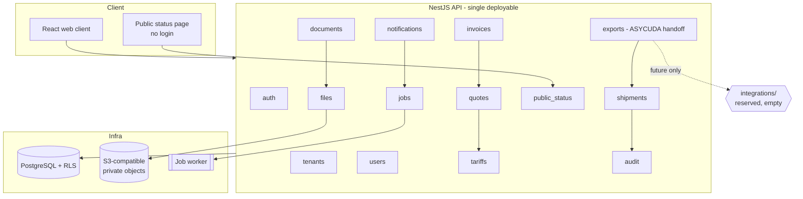

# Architecture

Clearing Agent Platform: a multi-tenant SaaS for small and mid-size clearing and
forwarding agents in Zambia. This document describes the target architecture and
what exists today. Phase 0 ships only the foundations described under "Status".

## Product boundary (read this first)

Declarations, duty assessment and release physically happen in **ASYCUDA World**,
the ZRA customs system. We do **not** integrate with, scrape, or automate
ASYCUDA. Our scope is the workflow *around* it: documents, client updates,
quotes, invoicing, shipment history, and a clean **one-way handoff export** of
data the agent keys into ASYCUDA.

Because there is no live status feed, **stage updates are manual** and optimized
for one tap on a phone.

## Style: modular monolith

One deployable API, internally split into modules with explicit service
interfaces. No module reaches into another module's tables. This keeps
infrastructure cost and operational complexity low while the customer base is
small, and leaves a clean path to extract a module later if ever needed.

### Target modules



Dashed edge to `integrations/` is a **documented boundary only**. Nothing is
built for ASYCUDA/ZRA now.

## Request flow (target)

```mermaid
sequenceDiagram
  participant U as Staff (mobile)
  participant W as Web client
  participant A as API
  participant P as Policy layer
  participant D as PostgreSQL (RLS)
  participant J as Job queue

  U->>W: One-tap stage update
  W->>A: PATCH /api/v1/shipments/:id/stage
  A->>A: Validate body (schema, reject unknown fields)
  A->>P: Authorize(permission, tenant scope)
  P-->>A: allow / deny (deny by default)
  A->>D: SET LOCAL app.tenant_id; write shipment + shipment_event
  D-->>A: ok
  A->>J: enqueue notify + invalidate status cache (idempotent)
  A-->>W: 200 + updated shipment (optimistic UI confirmed)
  J->>J: send WhatsApp/SMS/email, generate cache entry
```

Nothing here talks to ASYCUDA.

## Layering rules

- Each module exposes a service interface; controllers validate and delegate.
- Stateless app servers. No in-memory session state. Safe to run N replicas.
- Slow or external work runs as background jobs (PDF, notifications, file
  scanning, exports). Jobs are idempotent and retry-safe.
- API-first, versioned REST under `/api/v1`. OpenAPI is generated from code
  (`apps/api/src/openapi.ts`), never hand-written.
- Config over code: checklists, fee structures, stage labels and export field
  mappings are data, editable per agency.
- Notification channels sit behind a `NotificationProvider` interface with a
  mock for tests (`mock` is the Phase 0 default).

## Key decisions and trade-offs

| Decision | Why | Trade-off accepted |
|---|---|---|
| Modular monolith over microservices | Tiny market, low infra budget, one team | Must enforce module boundaries by discipline and review |
| Shared schema + `tenant_id` + RLS (not DB-per-tenant) | Cheapest at pilot scale; one migration path | Noisy-neighbour risk; later option to move a large tenant to its own DB |
| Postgres-backed job table first, Redis later | Avoid a second stateful service before it earns its keep | Lower throughput; revisit when job latency matters |
| Manual stage updates | No ASYCUDA integration allowed now | Staff must tap to update; UI must make that one tap |
| OpenAPI generated from code | Spec cannot drift | Decorators must be kept on every DTO |
| Money as integer minor units + ISO code | No float rounding errors on duty/VAT | Every layer must respect minor units |
| Forward-only migrations | Simple, auditable history | Rollback = restore from backup, so backups must be tested |

## Data and scaling path

Design now, implement when needed:

1. Single primary + connection pooling.
2. Short-TTL cache of public status payloads, invalidated on stage change.
3. Read replicas for reporting and public pages.
4. Time-partition `audit_logs`, `shipment_events`, `notifications`.
5. Object-storage lifecycle rules for files and generated PDFs.
6. Per-tenant rate limits and quotas.
7. One code path for tenant routing, so a large tenant can move to its own DB.

## Repository layout

```
apps/api        NestJS API (modular monolith)
apps/web        React + Vite client (mobile-first)
packages/shared Shared domain types and pure helpers
docker/         Dockerfiles + nginx config
docs/           Supplemental docs (performance, runbook, ai-safety — later)
.github/        CI: lint, typecheck, build, test, audit, secret scan
```

## Status

**Phase 0 (done):** monorepo, tooling, CI, Docker, `.env.example`, config
validation, structured logging with PII redaction, single error envelope,
health + generated OpenAPI, `ARCHITECTURE.md`, `SECURITY.md`.

**Not built yet:** database, migrations, auth, RLS, and all domain modules.
Those begin in Phase 1. The `integrations/` boundary is intentionally empty.
